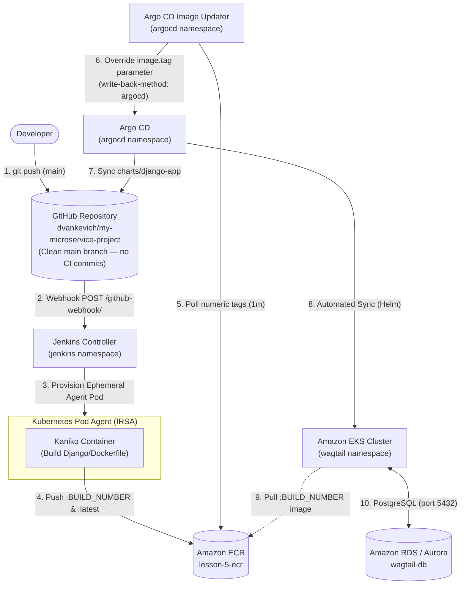

# AWS EKS Microservice Infrastructure & GitOps Platform (Terraform, Helm, Jenkins, Argo CD, Prometheus & Grafana)

This repository contains Terraform configurations, Helm charts, and the Django/Wagtail application source code to provision and operate a complete cloud-native platform on AWS (`eu-central-1`):

- **Core AWS Infrastructure**: Remote S3 Terraform state with native S3 locking, a multi-AZ VPC, a private Amazon ECR registry, an Amazon EKS cluster (`5 x t3.small` worker nodes across 3 Availability Zones), and a reusable Amazon RDS / Aurora PostgreSQL module isolated in private subnets.
- **Cluster Add-ons & Storage**: Multi-AZ `ingress-nginx` controller, `cert-manager` with a production Let's Encrypt `ClusterIssuer`, and a cluster-scoped encrypted `ebs-gp3` `StorageClass`.
- **GitOps CI/CD Pipeline**: A declarative Jenkins CI server using Kaniko and IRSA for passwordless ECR builds, paired with Argo CD and **Argo CD Image Updater** for automated, commit-free GitOps continuous delivery.
- **Observability Stack**: A lightweight Prometheus and **Grafana** monitoring module (`prometheus-server`, `kube-state-metrics`, `prometheus-node-exporter`, and Grafana over HTTPS at `https://grafana.dvankevich.pp.ua`, backed by persistent `ebs-gp3` volumes) tuned for `t3.small` resource limits.
- **Application Workload**: A Django/Wagtail Helm chart (`charts/django-app`) backed by managed AWS RDS PostgreSQL, an S3 bucket for images and documents (`wagtail-media-lesson5`, written via IRSA), dual L4 `LoadBalancer` / L7 HTTPS `Ingress` access, Horizontal Pod Autoscaling (HPA), and `topologySpreadConstraints`.

## Project Structure

```text
my-microservice-project/
├── .gitignore                        # Ignores Terraform state/cache, IDE files, and local secrets.yaml files
├── README.md                         # Main infrastructure, database, CI/CD, and monitoring documentation
├── backend.tf                        # S3 remote state backend configuration (native S3 lockfile)
├── main.tf                           # Root module wiring s3_backend, vpc, ecr, eks, cluster_addons, jenkins, argo_cd, monitoring, media_s3, and rds
├── variables.tf                      # Root input variables (including fallback db_password)
├── outputs.tf                        # Root outputs (S3, VPC, ECR, EKS, Ingress ELB, Jenkins, Argo CD, Prometheus, Grafana, media S3, and RDS)
├── .terraform.lock.hcl               # Provider dependency lock file
├── Django/                           # Django / Wagtail application source code and CI pipeline definition
│   ├── .dockerignore
│   ├── .gitignore                    # Ignores Python cache, virtualenvs, local SQLite, and media artifacts
│   ├── Dockerfile                    # Multi-stage production Docker image (Python 3.13 + Gunicorn)
│   ├── docker-compose.yml            # Local development stack (PostgreSQL + Django + Nginx)
│   ├── entrypoint.sh                 # Runs Django database migrations and starts Gunicorn
│   ├── Jenkinsfile                   # Declarative Kaniko build & ECR push pipeline (no Git write-back)
│   ├── manage.py
│   ├── requirements.txt
│   ├── home/
│   ├── mysite/
│   ├── nginx/
│   └── search/
├── docs/                             # Architectural diagrams, testing guides, and operational references
│   ├── ARCHITECTURE.md               # Overall AWS & Kubernetes architecture diagram (English)
│   ├── ARCHITECTURE_UA.md            # Overall AWS & Kubernetes architecture diagram (Ukrainian)
│   ├── ARGOCD_IMAGE_UPDATER.md       # Guide on eliminating CI commits to main via Argo CD Image Updater
│   ├── AUTOMATED_TESTING.md          # Documentation for the automated infrastructure test suite
│   ├── GRAFANA.md                    # Guide to Grafana setup, dashboards, and EKS PromQL visualizations
│   ├── LOAD_TESTING.md               # Load testing guide and HPA scaling verification scenarios
│   ├── PROMETHEUS_PROMQL.md          # Practical guide to Prometheus UI, Target Health, and PromQL queries
│   └── dynamodb_terraform_state.md
├── tests/
│   └── run-tests.sh                  # Automated TLS, HA, rolling update, and load testing script
├── modules/
│   ├── argo-cd/
│   │   ├── argo_cd.tf                # Helm releases for Argo CD, Image Updater, IRSA ECR token refresher, and argo-apps chart
│   │   ├── image-updater-values.yaml # Argo CD Image Updater registry and resource configuration
│   │   ├── outputs.tf                # Outputs Argo CD HTTPS URL and initial admin password command
│   │   ├── values.yaml               # Argo CD server configuration (Ingress TLS, server.insecure, resource limits)
│   │   ├── variables.tf              # Release name, namespace, chart versions, OIDC, ECR, and hostname variables
│   │   ├── versions.tf               # Required Helm and Kubernetes provider version constraints
│   │   └── charts/
│   │       ├── Chart.yaml            # Local Helm chart metadata for Argo CD Applications and ImageUpdaters
│   │       ├── values.yaml           # Declarative Application (django-app) and ImageUpdater CR definitions
│   │       └── templates/
│   │           ├── application.yaml   # Argo CD Application CRD template
│   │           ├── image-updater.yaml # Argo CD ImageUpdater (v1alpha1) CRD template
│   │           └── repository.yaml    # Argo CD Git repository Secret template
│   ├── cluster-addons/
│   │   ├── main.tf                   # Multi-AZ ingress-nginx, ebs-gp3 StorageClass, cert-manager, and ClusterIssuer
│   │   ├── outputs.tf                # Exports ingress_elb_hostname and cluster_issuer_name
│   │   ├── variables.tf              # Ingress replica count, ACME email, and ClusterIssuer variables
│   │   └── versions.tf               # Required Helm and Kubernetes provider version constraints
│   ├── ecr/
│   │   ├── ecr.tf
│   │   ├── outputs.tf
│   │   └── variables.tf
│   ├── eks/
│   │   ├── ebs-csi.tf                # OIDC provider, IAM role, and AWS EBS CSI driver add-on
│   │   ├── eks.tf                    # EKS cluster, cluster IAM role, and access configuration
│   │   ├── node.tf                   # Managed node group and node IAM role
│   │   ├── outputs.tf                # Exports cluster endpoint, name, node role ARN, and OIDC provider outputs
│   │   └── variables.tf
│   ├── jenkins/
│   │   ├── jenkins.tf                # IAM role (IRSA), Kubernetes Namespace/SA, and Jenkins Helm release
│   │   ├── outputs.tf                # Outputs release name, namespace, and HTTPS URL
│   │   ├── values.yaml               # Jenkins controller, plugins, Ingress, persistence, and JCasC seed-job
│   │   ├── secrets.yaml.example      # Template for Jenkins admin password and GitHub PAT (committed to Git)
│   │   ├── secrets.yaml              # Local sensitive JCasC credentials and admin password (gitignored)
│   │   ├── variables.tf              # Module input variables (including OIDC and dynamic ECR repository URL)
│   │   └── versions.tf               # Required Helm and Kubernetes provider version constraints
│   ├── monitoring/
│   │   ├── grafana-values.yaml       # Grafana persistence, Ingress TLS, resource limits, and Prometheus datasource config
│   │   ├── monitoring.tf             # Kubernetes namespace, Prometheus, Grafana, and monitoring-extras Helm releases
│   │   ├── outputs.tf                # Outputs namespace, Prometheus service URL, Grafana URL, and password commands
│   │   ├── values.yaml               # Prometheus server, node-exporter, and kube-state-metrics resource tuning
│   │   ├── variables.tf              # Release name, namespace, storage class/size, retention, and Grafana variables
│   │   ├── versions.tf               # Required Helm and Kubernetes provider version constraints
│   │   └── charts/
│   │       ├── Chart.yaml            # Local Helm chart metadata for custom scrape targets
│   │       ├── values.yaml           # Custom external/service scrape target definitions
│   │       └── templates/
│   │           └── custom-targets.yaml # Service & Endpoints template for custom Prometheus targets
│   ├── rds/
│   │   ├── aurora.tf                 # Amazon Aurora Cluster, writer/reader instances, and cluster parameter group
│   │   ├── outputs.tf                # Unified writer/reader endpoints, port, DB name, SG ID, and subnet group outputs
│   │   ├── rds.tf                    # Standard aws_db_instance and aws_db_parameter_group
│   │   ├── shared.tf                 # Shared aws_db_subnet_group and aws_security_group
│   │   ├── variables.tf              # Input variables for RDS, Aurora, networking, and DB engine parameters
│   │   └── versions.tf               # Required Terraform and AWS provider version constraints
│   ├── s3-backend/
│   │   ├── outputs.tf                # Outputs S3 bucket name
│   │   ├── s3.tf                     # S3 state bucket, versioning, and ownership controls
│   │   └── variables.tf              # Bucket name variable
│   ├── media-s3/
│   │   ├── s3.tf                     # Private-write public-read media bucket, encryption, versioning, CORS
│   │   ├── iam.tf                    # IRSA role for the Wagtail ServiceAccount
│   │   ├── outputs.tf                # Bucket name, domain, and role ARN
│   │   ├── variables.tf              # Bucket, OIDC, namespace, and CORS inputs
│   │   └── versions.tf               # Required Terraform and AWS provider version constraints
│   └── vpc/
│       ├── outputs.tf
│       ├── routes.tf
│       ├── variables.tf
│       └── vpc.tf
└── charts/
    └── django-app/
        ├── Chart.yaml
        ├── values.yaml               # Public application configuration (default image tag, RDS host, Service, Ingress, HPA)
        ├── secrets.yaml.example      # Template for sensitive credentials (committed to Git)
        └── templates/
            ├── serviceaccount.yaml  # ServiceAccount django with the media IRSA role annotation
            ├── configmap.yaml        # Non-sensitive environment variables (including POSTGRES_HOST, CSRF_TRUSTED_ORIGINS, and the media bucket)
            ├── secret.yaml           # Conditional Kubernetes Secret (controlled via createSecrets flag)
            ├── deployment.yaml       # Django/Wagtail Deployment with PostgreSQL readiness initContainer and topologySpreadConstraints
            ├── postgres.yaml         # Optional in-cluster PostgreSQL 16 Deployment and ClusterIP Service (postgres.enabled)
            ├── pvc.yaml              # PersistentVolumeClaim (5Gi) for optional in-cluster PostgreSQL data
            ├── service.yaml          # Configurable Service (LoadBalancer by default, switchable to ClusterIP)
            ├── ingress.yaml          # NGINX Ingress resource with cert-manager TLS annotations
            └── hpa.yaml              # HorizontalPodAutoscaler (2–6 replicas at >70% CPU utilization)
```

For a complete visual overview of the network topology, AWS resources, and Kubernetes workloads, see [`docs/ARCHITECTURE.md`](./docs/ARCHITECTURE.md) (or [`docs/ARCHITECTURE_UA.md`](./docs/ARCHITECTURE_UA.md)).

## Modules Overview

### `s3-backend` (`./modules/s3-backend`)

Provisions remote state storage in AWS using native S3 backend locking:

- **S3 Bucket (`s3.tf`)**: Creates the state bucket (`tfstate-bucket-lesson5`), enables **Versioning** to preserve state history, and enforces `BucketOwnerEnforced` object ownership.
- **State Locking**: Locking is handled natively by the S3 backend via `use_lockfile = true` in `backend.tf`. No separate DynamoDB table is required or provisioned.

### `media-s3` (`./modules/media-s3`)

Stores Wagtail images and documents for every replica of `django-app`:

- **Bucket (`s3.tf`)**: Creates `wagtail-media-lesson5` with versioning, AES-256 encryption, and `BucketOwnerEnforced` ownership. A bucket policy allows public `s3:GetObject`. Listing stays private. CORS allows the site and local admin origins to read images for the focal-point editor.
- **IRSA (`iam.tf`)**: Role `eks-cluster-demo-django-media` can be assumed only by `system:serviceaccount:wagtail:django`. It can list the bucket and get, put, and delete objects. Pods do not receive static access keys.

The Helm values `media.bucket` and `serviceAccount.annotations` must match this module. `terraform output media_s3_role_arn` prints the role ARN.

### `vpc` (`./modules/vpc`)

Provisions core networking in `eu-central-1` (`10.0.0.0/16` by default in `main.tf`) across three availability zones (`eu-central-1a`, `eu-central-1b`, `eu-central-1c`):

- **VPC, Subnets & NAT Gateway (`vpc.tf`)**: Creates a VPC with DNS support and DNS hostnames enabled, three public subnets (`10.0.1.0/24`, `10.0.2.0/24`, `10.0.3.0/24`) with `map_public_ip_on_launch = true`, three private subnets (`10.0.4.0/24`, `10.0.5.0/24`, `10.0.6.0/24`), an Internet Gateway (`igw`), and a single shared NAT Gateway (`nat`) with an Elastic IP (`aws_eip.nat`) placed in the first public subnet (`public[0]`) to keep environment costs low.
- **Routing (`routes.tf`)**: Creates a public route table with a `0.0.0.0/0` route pointing to the Internet Gateway associated with all public subnets, and a shared private route table with a `0.0.0.0/0` route pointing to the NAT Gateway associated with all private subnets.

### `ecr` (`./modules/ecr`)

Provisions a private Amazon ECR repository for container images:

- **Repository (`ecr.tf`)**: Creates an `aws_ecr_repository` (default name `lesson-5-ecr`) with `MUTABLE` image tags, `force_delete = true` (allowing deletion even when images are present), and `scan_on_push = true` enabled for vulnerability scanning.
- **Repository Policy (`ecr.tf`)**: Attaches an `aws_ecr_repository_policy` scoped to the current AWS account (`data.aws_caller_identity.current`) to allow image push and pull operations for account principals and workloads.

### `eks` (`./modules/eks`)

Provisions a managed Amazon EKS cluster in `eu-central-1` running on the public subnets created by the `vpc` module:

- **Cluster & IAM Role (`eks.tf`)**: Creates an IAM role for the EKS control plane with `AmazonEKSClusterPolicy` attached, then creates the `aws_eks_cluster` resource (`eks-cluster-demo`). The cluster is configured with both public and private API endpoint access and uses `authentication_mode = "API"` together with `bootstrap_cluster_creator_admin_permissions = true`.
- **Managed Node Group (`node.tf`)**: Creates a managed node group (`general`) using `t3.small` instances (`desired_size = 5`, `min_size = 5`, `max_size = 6`).
  - **Why `5 x t3.small` nodes:** In AWS EKS, the VPC CNI plugin restricts `t3.small` instances (2 GiB RAM) to **11 pods per node** due to ENI IP address limits. Running 5 `t3.small` nodes (55 pod slots total) provides sufficient capacity and memory headroom for system add-ons (`coredns`, `aws-node`, `kube-proxy`, `ebs-csi`), Multi-AZ `ingress-nginx`, `cert-manager`, `metrics-server`, horizontally scaled Django pods (up to 6 replicas via HPA), Argo CD + Image Updater, the Jenkins controller with dynamic Kaniko agent pods, and the Prometheus + Grafana observability stack without `Too many pods` or memory scheduling bottlenecks.
  - **Autoscaler Lifecycle Rule:** `node.tf` includes `lifecycle { ignore_changes = [scaling_config[0].desired_size] }` to prevent Terraform from conflicting with cluster autoscalers. When changing `desired_size` on an existing cluster, update it via AWS CLI (`aws eks update-nodegroup-config`).
- **EBS CSI Driver & IRSA (`ebs-csi.tf` & `outputs.tf`)**: Provisions an IAM OIDC identity provider for the cluster, creates a dedicated IAM role with `AmazonEBSCSIDriverPolicy` bound to `kube-system:ebs-csi-controller-sa`, installs the `aws-ebs-csi-driver` EKS add-on, and exports `oidc_provider_arn` and `oidc_provider_url` for downstream IRSA roles.
- **IAM Permissions:** The node IAM role is attached with `AmazonEKSWorkerNodePolicy`, `AmazonEKS_CNI_Policy`, and `AmazonEC2ContainerRegistryReadOnly`.

### `cluster-addons` (`./modules/cluster-addons`)

Provisions cluster-wide ingress, storage class, and TLS certificate management via the Terraform `helm` and `kubernetes` providers:

- **Multi-AZ `ingress-nginx` (`main.tf`)**: Installs `ingress-nginx` with `replicaCount = 2` and `topologySpreadConstraints` keyed on `topology.kubernetes.io/zone` (`maxSkew = 1`, `whenUnsatisfiable = "ScheduleAnyway"`), sharing a single AWS LoadBalancer without single-AZ failure points.
- **Cluster StorageClass (`main.tf`)**: Provisions `kubernetes_storage_class_v1.ebs_gp3` (`ebs.csi.aws.com`, `volume_binding_mode = "WaitForFirstConsumer"`, `allow_volume_expansion = true`, encrypted `gp3` volumes) at the cluster level so persistent volumes for Jenkins, Prometheus, and Grafana remain decoupled from application Helm charts.
- **`cert-manager` & `ClusterIssuer` (`main.tf`)**: Installs `cert-manager` (`crds.enabled = true`) and provisions the production Let's Encrypt `ClusterIssuer` (`letsencrypt-prod`) using HTTP-01 challenge validation via the `nginx` ingress class.
- **ELB Hostname Output (`outputs.tf`)**: Exports `ingress_elb_hostname` so DNS `CNAME` records for `django-app.dvankevich.pp.ua`, `jenkins.dvankevich.pp.ua`, `argocd.dvankevich.pp.ua`, and `grafana.dvankevich.pp.ua` can be retrieved directly from Terraform outputs.

### `jenkins` (`./modules/jenkins`)

Deploys Jenkins into the `jenkins` namespace using the Terraform `helm` and `kubernetes` providers authenticated via short-lived EKS IAM tokens (`data.aws_eks_cluster_auth`):

- **IRSA for Kaniko ECR Builds (`jenkins.tf`)**: Creates an IAM role (`eks-cluster-demo-jenkins-kaniko-role`) with ECR push/pull permissions and binds it to the `jenkins-sa` Kubernetes `ServiceAccount` (`eks.amazonaws.com/role-arn`). Ephemeral Kaniko build pods assume this role automatically without static AWS keys or privileged Docker-in-Docker daemons.
- **Helm Release & Ingress (`jenkins.tf` & `values.yaml`)**: Installs the official `jenkinsci/jenkins` chart as a `ClusterIP` service and exposes it over HTTPS (`https://jenkins.dvankevich.pp.ua`) through `ingress-nginx` and `cert-manager` (`letsencrypt-prod`).
- **Persistent Storage**: Provisions a dedicated `10Gi` AWS EBS volume via the `ebs-gp3` `StorageClass` (`persistence.storageClass = "ebs-gp3"`) to persist `/var/jenkins_home` across pod restarts.
- **Declarative JCasC & Seed Job (`values.yaml` & `secrets.yaml`)**:
  - Injects `module.ecr.repository_url` dynamically via `templatefile` as a global Jenkins environment variable (`ECR_REPO_URL`).
  - Loads the Jenkins admin password and GitHub Fine-grained Personal Access Token (`github-token`) from the gitignored `modules/jenkins/secrets.yaml` file.
  - Automatically configures `seed-job` using the `job-dsl` plugin to generate the `django-wagtail-ci` pipeline with `triggers { githubPush() }` targeting `https://github.com/dvankevich/my-microservice-project.git` (`Django/Jenkinsfile`).

### `argo-cd` (`./modules/argo-cd`)

Deploys Argo CD and **Argo CD Image Updater** into the `argocd` namespace as the GitOps Continuous Delivery engine:

- **Core Argo CD Release (`argo_cd.tf` & `values.yaml`)**: Installs the official `argoproj/argo-cd` Helm chart as a `ClusterIP` service behind `ingress-nginx` and `cert-manager` (`https://argocd.dvankevich.pp.ua`). Sets `configs.params.server.insecure: true` so TLS terminates cleanly at `ingress-nginx`, and disables optional components (`dex`, `notifications`, `applicationSet`) to conserve pod slots on `t3.small` nodes.
- **IRSA ECR Authentication & Token Refresh (`argo_cd.tf`)**: Provisions an IAM role (`eks-cluster-demo-argocd-ecr-role`) bound to the `ecr-token-refresher` `ServiceAccount` with ECR authorization and read permissions (`ecr:GetAuthorizationToken`, `ecr:ListImages`, `ecr:DescribeImages`, etc.). An initial `Job` (`ecr-token-init`) and a periodic `CronJob` (`ecr-token-refresh`, running every 6 hours via `public.ecr.aws/aws-cli/aws-cli` + `alpine/kubectl`) keep the `ecr-credentials` Docker registry secret valid.
- **Argo CD Image Updater (`argo_cd.tf` & `image-updater-values.yaml`)**: Installs `argocd-image-updater` (`v1.5.0+`), polling Amazon ECR every `1m` without making automated commits to `main`.
- **Declarative Applications & ImageUpdaters Chart (`argo_cd.tf` & `charts/`)**: Deploys a local `argo-apps` Helm release that provisions:
  - The `django-app` `Application` custom resource watching `charts/django-app` on `main` with automated `prune: true`, `selfHeal: true`, and `createSecrets=false`.
  - The `django-app-updater` `ImageUpdater` (`argocd-image-updater.argoproj.io/v1alpha1`) custom resource tracking numeric image tags (`regexp:^[0-9]+$`) with the `newest-build` strategy and `writeBackConfig.method: argocd` (updating `image.repository` and `image.tag` directly in the `Application` spec).

### `monitoring` (`./modules/monitoring`)

Deploys Prometheus and **Grafana** observability into the `monitoring` namespace via Terraform and Helm:

- **Prometheus Stack (`monitoring.tf` & `values.yaml`)**: Installs `prometheus-community/prometheus` with `prometheus-server` (`ClusterIP`, `3d` retention, `5Gi` `ebs-gp3` PersistentVolumeClaim), `kube-state-metrics`, and `prometheus-node-exporter` (DaemonSet across all 5 EKS nodes). `alertmanager` and `prometheus-pushgateway` are disabled by default to fit `t3.small` pod density and memory budgets.
- **Grafana Visualization (`monitoring.tf` & `grafana-values.yaml`)**: Installs `grafana/grafana` (`requests: 50m CPU / 128Mi RAM`, `limits: 250m CPU / 256Mi RAM`) backed by a `2Gi` `ebs-gp3` PersistentVolumeClaim (`grafana.db`), exposed over HTTPS (`https://grafana.dvankevich.pp.ua`) via `ingress-nginx` and `cert-manager` (`letsencrypt-prod`), with a generated admin password stored in `grafana-admin-secret` and `Prometheus (main)` pre-configured as the default data source.
- **Custom Scrape Targets Chart (`monitoring.tf` & `charts/`)**: Deploys a local `monitoring-extras` Helm release capable of registering external or custom endpoints via headless `Service` and `Endpoints` manifests with `prometheus.io/scrape: "true"` annotations.
- **Outputs (`outputs.tf`)**: Exports `prometheus_service_url`, `prometheus_port_forward_command`, `grafana_url`, and `grafana_admin_password_command`.

### `rds` (`./modules/rds`)

Provisions a reusable managed relational database layer in AWS capable of deploying either a single **Amazon RDS instance** or a clustered **Amazon Aurora** deployment controlled by the `use_aurora` flag:

- **Dual-Mode Architecture (`rds.tf` & `aurora.tf`)**:
  - `use_aurora = false`: Provisions a standalone `aws_db_instance` paired with a dedicated `aws_db_parameter_group`.
  - `use_aurora = true`: Provisions an `aws_rds_cluster`, a primary `writer` instance (`aws_rds_cluster_instance`), optional `read-only` replicas (`aurora_replica_count`), and an `aws_rds_cluster_parameter_group`.
- **Shared Network & Security Isolation (`shared.tf`)**: Automatically creates an `aws_db_subnet_group` (selecting private subnets when `publicly_accessible = false` or public subnets when `true`) and an `aws_security_group` restricting database port ingress to `allowed_cidr_blocks` (defaulting to the VPC CIDR `10.0.0.0/16`).
- **Dynamic Engine Tuning**: Applies custom database parameters (`max_connections`, `log_statement`, `work_mem`, etc.) via a `dynamic "parameter"` block and exports unified `db_endpoint`, `db_reader_endpoint`, and `db_port` outputs regardless of the underlying engine mode.

## Usage

Run Terraform commands from the repository root with valid AWS credentials configured for `eu-central-1`:

```bash
cd my-microservice-project
```

### Initialize

Download providers, initialize modules, and configure the remote state backend:

```bash
terraform init
```

### Plan

Ensure `modules/jenkins/secrets.yaml` and `charts/django-app/secrets.yaml` have been created from their `.example` templates, then preview the execution plan:

```bash
terraform plan
```

### Apply

Provision or update the infrastructure in AWS:

```bash
terraform apply
```

*(Note: When provisioning a brand-new cluster from scratch, `kubernetes_manifest` in `module.cluster_addons` requires the `cert-manager.io/v1` CRD to exist before planning. Deploy core AWS resources and `cert-manager` first via `terraform apply -target=module.vpc -target=module.ecr -target=module.eks -target=module.rds -target=module.cluster_addons.helm_release.cert_manager`, prepare `modules/jenkins/secrets.yaml`, and then run `terraform apply` to finish deploying `module.cluster_addons`, `module.jenkins`, `module.argo_cd`, and `module.monitoring`.)*

## Build and Push Django Docker Image to ECR (Manual Bootstrap)

Before building the initial image, ensure `Django/mysite/settings/docker.py` configures HTTPS proxy headers and reads `CSRF_TRUSTED_ORIGINS` from the environment so Django 6.1 allows `POST` requests (such as `/admin/login/`) behind `ingress-nginx`:

```python
csrf_origins = os.environ.get("CSRF_TRUSTED_ORIGINS", "")
CSRF_TRUSTED_ORIGINS = [
    origin.strip() for origin in csrf_origins.split(",") if origin.strip()
]
SECURE_PROXY_SSL_HEADER = ("HTTP_X_FORWARDED_PROTO", "https")
```

### 1. Export ECR Repository Variables

Retrieve the repository URI from Terraform outputs (using `-raw` to omit quotes) and extract the registry URL and repository name:

```bash
export AWS_REGION="eu-central-1"
export ECR_REPO_URL=$(terraform output -raw repository_url)
export ECR_REGISTRY="${ECR_REPO_URL%/*}"
export ECR_REPO_NAME="${ECR_REPO_URL#*/}"
```

### 2. Authenticate Docker with Amazon ECR

Log in to your private ECR registry:

```bash
aws ecr get-login-password --region "$AWS_REGION" | docker login --username AWS --password-stdin "$ECR_REGISTRY"
```

### 3. Build and Push the Docker Image

Navigate to `Django/`, build the image targeting `linux/amd64`, and push it to ECR:

```bash
cd Django
docker build --platform linux/amd64 -t "$ECR_REPO_URL:latest" .
docker push "$ECR_REPO_URL:latest"
aws ecr list-images --repository-name "$ECR_REPO_NAME" --region "$AWS_REGION"
cd ..
```

*(Once Jenkins and Argo CD are deployed, subsequent image builds and ECR pushes are automated through the `django-wagtail-ci` Kaniko pipeline, and new image tags are deployed automatically by Argo CD Image Updater.)*

## Deploy Ingress, TLS (`cert-manager`), and Django Application to EKS

The `charts/django-app` Helm chart separates non-sensitive configuration (`ConfigMap` via `values.yaml`) from sensitive credentials (`Kubernetes Secret` via `secrets.yaml`), connects to the external AWS RDS PostgreSQL instance (or an optional in-cluster PostgreSQL pod when `postgres.enabled: true`), and supports both direct L4 `LoadBalancer` access and L7 HTTPS termination via `ingress-nginx` and Let's Encrypt.

### 1. Configure `kubectl` for EKS

Update your local kubeconfig to connect to the `eks-cluster-demo` cluster and verify all nodes are `Ready`:

```bash
aws eks update-kubeconfig --region "$AWS_REGION" --name eks-cluster-demo
kubectl get nodes -L topology.kubernetes.io/zone
```

### 2. Verify `cluster-addons` and Configure DNS

Verify that the Multi-AZ `ingress-nginx-controller` pods are running across distinct Availability Zones, `ebs-gp3` `StorageClass` exists, and `letsencrypt-prod` `ClusterIssuer` is `Ready`:

```bash
kubectl get pods -n ingress-nginx -o wide
kubectl get sc ebs-gp3
kubectl get clusterissuer
```

Retrieve the `ingress-nginx` AWS LoadBalancer DNS hostname from Terraform outputs:

```bash
terraform output -raw ingress_elb_hostname
```

Configure DNS for your application domain (`django-app.dvankevich.pp.ua`):

- **Recommended (`CNAME` record):** Point `django-app` to the `ingress_elb_hostname` (`<id>.eu-central-1.elb.amazonaws.com`).
- **Alternative (`A` record):** Resolve the ELB's current IPv4 addresses with `dig +short <ingress_elb_hostname>` and add them as `A` records.

Verify DNS propagation before issuing certificates:

```bash
dig +short django-app.dvankevich.pp.ua
```

### 3. Prepare Local Secrets File

Copy the example secrets template and populate your actual `SECRET_KEY` and `POSTGRES_PASSWORD` (ensure `POSTGRES_PASSWORD` is 8–128 printable ASCII characters without `/`, `@`, `"`, or spaces so it is valid for both AWS RDS and Django). All `**/secrets.yaml` files are excluded via `.gitignore` so credentials are never committed to version control:

```bash
cp charts/django-app/secrets.yaml.example charts/django-app/secrets.yaml
# Edit charts/django-app/secrets.yaml with your actual credentials
```

### 4. Validate and Install the Helm Chart (`LoadBalancer` + `Ingress`)

In `charts/django-app/values.yaml`, `service.type` is set to `LoadBalancer` by default to expose a direct L4 AWS ELB on port `80 -> 8000`, while `ingress.enabled: true` simultaneously routes HTTPS traffic (`https://django-app.dvankevich.pp.ua`) through the Multi-AZ `ingress-nginx` controller and `cert-manager`:

```yaml
service:
  type: LoadBalancer # Switch: "LoadBalancer" (default) or "ClusterIP" (Ingress-only mode)
  port: 80
  targetPort: 8000
```

Lint the chart and deploy the release into the `wagtail` namespace, passing both `values.yaml` and your local `secrets.yaml`:

```bash
helm lint ./charts/django-app

helm upgrade --install django-app ./charts/django-app \
  -n wagtail \
  --create-namespace \
  -f ./charts/django-app/values.yaml \
  -f ./charts/django-app/secrets.yaml
```

*(To deploy without creating a separate application ELB and route traffic solely through `ingress-nginx`, override the switch with `--set service.type=ClusterIP`. If updating an existing deployment manually after pushing a new image with the `:latest` tag, run `kubectl rollout restart deployment/django-app-django -n wagtail`.)*

### 5. Verify the Deployment, LoadBalancer, and TLS Certificate

Check that all pods are `Running`, `django-app-django` has an `EXTERNAL-IP` LoadBalancer, and the TLS `Certificate` reaches `READY: True` (takes ~1–2 minutes for the Let's Encrypt HTTP-01 challenge):

```bash
kubectl get pods,svc,ingress,certificate,hpa,secret -n wagtail
```

Verify both L7 HTTPS access (via `ingress-nginx`) and direct L4 HTTP access (via the `LoadBalancer` service):

```bash
curl -I https://django-app.dvankevich.pp.ua
curl -I http://$(kubectl get svc django-app-django -n wagtail -o jsonpath='{.status.loadBalancer.ingress[0].hostname}')
```

### 6. Create Django/Wagtail Superuser

Once the `django` pods reach the `1/1 Running` state (ensuring database migrations in `entrypoint.sh` have completed), create an administrative user non-interactively via environment variables:

```bash
kubectl exec deployment/django-app-django -n wagtail -- \
  env DJANGO_SUPERUSER_USERNAME=admin \
      DJANGO_SUPERUSER_EMAIL=admin@example.com \
      DJANGO_SUPERUSER_PASSWORD=your_password \
  python manage.py createsuperuser --noinput
```

*(Alternatively, run `kubectl exec -it deployment/django-app-django -n wagtail -- python manage.py createsuperuser` for interactive prompts.)*

Afterward, sign in to the Wagtail admin interface at `https://django-app.dvankevich.pp.ua/admin/`.

> **Note:** Because application data is stored in the managed Amazon RDS PostgreSQL database (`wagtail-db`), tables and user accounts persist independently of EKS pod lifecycles.

## Horizontal Pod Autoscaler (HPA) Configuration

Amazon EKS does not include `metrics-server` by default. Without it, `HorizontalPodAutoscaler` reports `cpu: <unknown>/70%` and cannot scale workloads.

### 1. Install `metrics-server`

Install `metrics-server` into the `kube-system` namespace:

```bash
helm repo add metrics-server https://kubernetes-sigs.github.io/metrics-server/
helm repo update

helm upgrade --install metrics-server metrics-server/metrics-server \
  -n kube-system \
  --set 'args[0]=--kubelet-insecure-tls'
```

Verify that node and pod resource metrics are available (takes ~30–60 seconds):

```bash
kubectl top nodes
kubectl top pods -n wagtail
```

### 2. Configure HPA Parameters in `values.yaml`

The Helm chart (`templates/hpa.yaml` using `autoscaling/v2`) scales `django-app-django` based on CPU utilization relative to the pod's `100m` CPU request:

```yaml
replicaCount: 2

resources:
  requests:
    cpu: 100m
    memory: 200Mi
  limits:
    cpu: 400m
    memory: 400Mi

autoscaling:
  enabled: true
  minReplicas: 2
  maxReplicas: 6
  targetCPUUtilizationPercentage: 70
```

Apply the configuration and verify that HPA reads live CPU utilization (`cpu: 1%/70%`) and maintains between `2` and `6` replicas:

```bash
helm upgrade --install django-app ./charts/django-app \
  -n wagtail \
  -f ./charts/django-app/values.yaml \
  -f ./charts/django-app/secrets.yaml

kubectl get hpa,pods -n wagtail
```

> **Load Testing:** For instructions and automated verification scripts covering TLS, High Availability, Zero-Downtime Rolling Updates, and HPA scaling, see [`docs/LOAD_TESTING.md`](./docs/LOAD_TESTING.md) and [`docs/AUTOMATED_TESTING.md`](./docs/AUTOMATED_TESTING.md).

## Pod Distribution & High Availability (`topologySpreadConstraints`)

By default, the Kubernetes scheduler places new pods based solely on available node resources. During pod recreation (self-healing) or HPA scale-out events, multiple Django replicas can end up scheduled on the same worker node, reducing fault tolerance if that node or Availability Zone fails.

To prevent single-node concentration, both the Ingress layer (`modules/cluster-addons/main.tf`, spreading `ingress-nginx-controller` across `topology.kubernetes.io/zone`) and the application layer (`charts/django-app/templates/deployment.yaml`) enforce `topologySpreadConstraints`:

```yaml
topologySpreadConstraints:
  - maxSkew: 1
    topologyKey: kubernetes.io/hostname
    whenUnsatisfiable: ScheduleAnyway
    labelSelector:
      matchLabels:
        app: {{ .Release.Name }}-django
```

- **`maxSkew: 1`:** Limits the difference in Django pod counts between any two worker nodes to at most `1`.
- **`topologyKey: kubernetes.io/hostname`:** Spreads pods evenly across distinct EKS worker nodes. Because the node group spans multiple public subnets (`eu-central-1a`, `eu-central-1b`, `eu-central-1c`), this also provides Multi-AZ resilience.
- **`whenUnsatisfiable: ScheduleAnyway`:** Applies a soft scheduling constraint so pods are evenly balanced during normal operation and self-healing, while still allowing replicas to run on a surviving node if another node becomes unavailable.

Verify that Django and Ingress replicas are scheduled across distinct nodes and Availability Zones:

```bash
kubectl get pods -n wagtail -o wide
kubectl get pods -n ingress-nginx -o wide
```

## Deploy Managed Database (AWS RDS / Aurora)

The reusable `./modules/rds` Terraform module abstracts database provisioning behind a single `use_aurora` boolean switch, automatically creating the `aws_db_subnet_group`, `aws_security_group`, and engine-specific parameter group (`aws_db_parameter_group` or `aws_rds_cluster_parameter_group`).

### 1. Module Usage Example (`main.tf`)

In `main.tf`, `locals` reads `POSTGRES_PASSWORD` directly from the gitignored `charts/django-app/secrets.yaml` file (falling back to `var.db_password` if the file is absent) so Terraform and Kubernetes share a single source of truth for credentials:

```hcl
locals {
  django_secrets = try(
    yamldecode(file("${path.module}/charts/django-app/secrets.yaml")).secrets,
    {}
  )
  db_password = coalesce(
    try(local.django_secrets["POSTGRES_PASSWORD"], null),
    var.db_password
  )
}

module "rds" {
  source = "./modules/rds"

  name                 = "wagtail-db"
  use_aurora           = false # false = standard RDS instance; true = Aurora Cluster + writer
  aurora_replica_count = 0     # Number of read-only replicas when use_aurora = true

  # --- Standard RDS-only ---
  engine                     = "postgres"
  engine_version             = "16"
  parameter_group_family_rds = "postgres16"
  allocated_storage          = 20

  # --- Aurora-only ---
  engine_cluster                = "aurora-postgresql"
  engine_version_cluster        = "16.4"
  parameter_group_family_aurora = "aurora-postgresql16"

  # --- Common Configuration ---
  instance_class          = "db.t3.micro"
  db_name                 = "wagtail"
  username                = "wagtail_user"
  password                = local.db_password
  vpc_id                  = module.vpc.vpc_id
  subnet_private_ids      = module.vpc.private_subnets
  subnet_public_ids       = module.vpc.public_subnets
  publicly_accessible     = false
  allowed_cidr_blocks     = ["10.0.0.0/16"]
  multi_az                = false
  backup_retention_period = 1
  skip_final_snapshot     = true

  parameters = {
    max_connections = "100"
    log_statement   = "ddl"
    work_mem        = "8192" # 8 MB (specified in KB for PostgreSQL)
  }

  tags = {
    Environment = "dev"
    Project     = "wagtail-eks"
  }
}
```

### 2. Input Variables Reference (`modules/rds/variables.tf`)

| Variable | Type | Default | Description |
| :--- | :--- | :--- | :--- |
| `name` | `string` | *(required)* | Base identifier used to name the RDS instance or Aurora cluster, subnet group, security group, and parameter group. |
| `use_aurora` | `bool` | `false` | Architecture mode switch: `true` deploys an Amazon Aurora cluster (`aws_rds_cluster` + writer/reader instances); `false` deploys a single standard `aws_db_instance`. |
| `engine` | `string` | `"postgres"` | Database engine for standard RDS (`postgres`, `mysql`, `mariadb`, etc.). |
| `engine_version` | `string` | `"16"` | Engine version for standard RDS (accepts major version like `"16"` or specific minor version like `"17.2"`). |
| `parameter_group_family_rds` | `string` | `"postgres16"` | Parameter group family for standard RDS. Must match `engine` and `engine_version` (e.g., `postgres16`, `postgres17`, `mysql8.0`). |
| `allocated_storage` | `number` | `20` | Storage capacity in GiB for standard RDS (not used by Aurora, which scales storage automatically). |
| `engine_cluster` | `string` | `"aurora-postgresql"` | Database engine for Aurora clusters (`aurora-postgresql` or `aurora-mysql`). |
| `engine_version_cluster` | `string` | `"16.4"` | Engine version for Aurora clusters (must be an AWS-supported Aurora release). |
| `parameter_group_family_aurora` | `string` | `"aurora-postgresql16"` | Cluster parameter group family for Aurora. Must match `engine_cluster` and `engine_version_cluster` (e.g., `aurora-postgresql16`, `aurora-mysql8.0`). |
| `aurora_replica_count` | `number` | `0` | Number of read-only Aurora replica instances created alongside the primary `writer` instance when `use_aurora = true`. |
| `instance_class` | `string` | `"db.t3.micro"` | Compute/memory instance class (`db.t3.micro` for AWS Free Tier standard RDS; `db.t3.medium`, `db.r6g.large`, etc. for Aurora or production). |
| `db_name` | `string` | *(required)* | Name of the initial database created when the instance or cluster initializes. |
| `username` | `string` | *(required)* | Master database administrator username. |
| `password` | `string` (`sensitive`) | *(required)* | Master database administrator password (8–128 printable ASCII characters, excluding `/`, `@`, `"`, and spaces). |
| `multi_az` | `bool` | `false` | Enables Multi-AZ standby replication for standard RDS (`use_aurora = false`). |
| `backup_retention_period` | `number` | `1` | Number of days to retain automated backups (`0` disables automated backups). |
| `skip_final_snapshot` | `bool` | `true` | Skips creating a final DB snapshot on deletion (`true` recommended for dev/test; set to `false` in production). |
| `vpc_id` | `string` | *(required)* | ID of the VPC where the database and its Security Group are created. |
| `subnet_private_ids` | `list(string)` | *(required)* | List of private subnet IDs used by `aws_db_subnet_group` when `publicly_accessible = false`. |
| `subnet_public_ids` | `list(string)` | *(required)* | List of public subnet IDs used by `aws_db_subnet_group` when `publicly_accessible = true`. |
| `publicly_accessible` | `bool` | `false` | Controls public IP allocation and subnet selection (`false` isolates the database in private subnets; `true` places it in public subnets). |
| `db_port` | `number` | `5432` | TCP port opened in the Security Group and assigned to the database (`5432` for PostgreSQL, `3306` for MySQL/MariaDB). |
| `allowed_cidr_blocks` | `list(string)` | `["10.0.0.0/16"]` | CIDR ranges permitted to connect to `db_port` in the database Security Group. |
| `parameters` | `map(string)` | `max_connections="100"`, `log_statement="ddl"`, `work_mem="8192"` | Key-value map of custom engine parameters applied to the DB or Cluster Parameter Group (`pending-reboot`). |
| `tags` | `map(string)` | `{}` | Map of AWS resource tags applied to all resources created by the module. |

### 3. How to Switch Database Type, Engine, Instance Class & Scaling

All database architecture settings are controlled via `module "rds"` in `main.tf`:

- **Switch between Standard RDS PostgreSQL and Amazon Aurora PostgreSQL:**
  Because `engine_cluster = "aurora-postgresql"`, `engine_version_cluster = "16.4"`, and `parameter_group_family_aurora = "aurora-postgresql16"` are already configured in `main.tf`, switching modes requires changing only `use_aurora` and `instance_class`:
  - **Standard RDS PostgreSQL (AWS Free Tier compatible):**
    ```hcl
    use_aurora     = false
    instance_class = "db.t3.micro"
    ```
  - **Amazon Aurora PostgreSQL Cluster:**
    ```hcl
    use_aurora           = true
    aurora_replica_count = 1              # 1 primary writer + 1 read-only replica (set 0 for writer-only)
    instance_class       = "db.t3.medium" # Aurora requires db.t3.medium or db.r* instance classes
    ```
- **Change PostgreSQL Version or Reuse the Module for MySQL:**
  - To change the PostgreSQL major version, update `engine_version` and `parameter_group_family_rds` (e.g., `"17"` and `"postgres17"`) or `engine_version_cluster` and `parameter_group_family_aurora`.
  - When reusing `./modules/rds` in another project with MySQL, set `engine = "mysql"` (`parameter_group_family_rds = "mysql8.0"`) or `engine_cluster = "aurora-mysql"` (`parameter_group_family_aurora = "aurora-mysql8.0"`) along with `db_port = 3306`.
- **Scale Compute, Storage, or High Availability:**
  - Upgrade `instance_class` (e.g., from `"db.t3.micro"` to `"db.t3.small"` or `"db.t3.medium"`).
  - Increase `allocated_storage` (e.g., from `20` to `50` GiB) for standard RDS.
  - Enable `multi_az = true` for synchronous standby failover on standard RDS.
- **Tune PostgreSQL Engine Parameters:**
  Adjust entries in the `parameters` map (PostgreSQL memory parameters such as `work_mem` must be specified as integer strings in **kilobytes**, e.g., `"8192"` for `8 MB`):
  ```hcl
  parameters = {
    max_connections            = "200"
    log_statement              = "ddl"
    log_min_duration_statement = "500"
    work_mem                   = "16384"
  }
  ```

### 4. Provision RDS and Connect Django/Wagtail

1. **Apply the `rds` module via Terraform:**
   ```bash
   terraform init
   terraform apply -target=module.rds
   terraform output -raw rds_endpoint
   ```
2. **Verify the RDS instance and custom parameter group in AWS:**
   ```bash
   aws rds describe-db-instances \
     --region eu-central-1 \
     --db-instance-identifier wagtail-db \
     --query 'DBInstances[0].{Status:DBInstanceStatus,Engine:Engine,Version:EngineVersion,Class:DBInstanceClass,Endpoint:Endpoint.Address}'

   aws rds describe-db-parameters \
     --region eu-central-1 \
     --db-parameter-group-name wagtail-db-rds-params \
     --source user \
     --output table
   ```
3. **Point `charts/django-app/values.yaml` to the RDS endpoint:**
   Set `postgres.enabled: false` (to free node RAM and pod slots on EKS) and update `env.POSTGRES_HOST` (`<rds_endpoint>`) and `env.POSTGRES_USER` (`"wagtail_user"`). Ensure `django-app-secret` in the `wagtail` namespace holds the matching `POSTGRES_PASSWORD`:
   ```bash
   helm template django-app ./charts/django-app \
     -s templates/secret.yaml \
     -f ./charts/django-app/secrets.yaml \
     --set createSecrets=true | kubectl apply -n wagtail -f -
   ```
4. **Commit and push `values.yaml` to `main`:** Argo CD automatically updates `ConfigMap` (`django-app-config`) and rolls out the Django pods connected to Amazon RDS.

## Deploy Jenkins CI/CD Server & Kaniko ECR Pipeline

Jenkins is provisioned via `./modules/jenkins`, integrating IRSA for passwordless ECR image pushes, JCasC for declarative credentials and job generation, and Kubernetes pod agents running Kaniko.

### 1. Configure DNS for Jenkins

In your DNS provider for `dvankevich.pp.ua`, create a `CNAME` record for `jenkins` pointing to the same `ingress_elb_hostname` (`<id>.eu-central-1.elb.amazonaws.com`) used by `django-app`:

```bash
terraform output -raw ingress_elb_hostname
dig +short jenkins.dvankevich.pp.ua
```

### 2. Ensure Sufficient Cluster Capacity (5 Nodes)

Ensure `desired_size = 5`, `min_size = 5`, and `max_size = 6` are set in `main.tf` and verify active node capacity via AWS CLI so there are enough pod slots and memory for the Jenkins controller, Argo CD + Image Updater, Prometheus + Grafana monitoring, and dynamic Kaniko agent pods alongside Django and Multi-AZ `ingress-nginx`:

```bash
aws eks update-nodegroup-config \
  --region eu-central-1 \
  --cluster-name eks-cluster-demo \
  --nodegroup-name general \
  --scaling-config minSize=5,maxSize=6,desiredSize=5

kubectl get nodes
```

### 3. Configure Local Jenkins Secrets (`secrets.yaml`)

1. Generate a **Fine-grained Personal Access Token** in GitHub (*Settings → Developer settings → Personal access tokens → Fine-grained tokens*) scoped to `dvankevich/my-microservice-project` with **`Contents: Read-only`** permission (because Argo CD Image Updater handles image tag updates in Kubernetes, Jenkins never writes commits back to Git).
2. Copy the example secrets template and populate your Jenkins admin password and GitHub PAT:

```bash
cp modules/jenkins/secrets.yaml.example modules/jenkins/secrets.yaml
# Edit modules/jenkins/secrets.yaml with your admin password and github_pat_... token
```

### 4. Apply Terraform to Deploy Jenkins & IRSA

Initialize the providers and apply the configuration (`module.cluster_addons` ensures the `ebs-gp3` `StorageClass` exists prior to creating the Jenkins PVC):

```bash
terraform init
terraform apply
```

*(Note: If the `jenkins` namespace already exists in the cluster from a prior manual installation, import it into state first via `terraform import module.jenkins.kubernetes_namespace_v1.jenkins jenkins` before running `terraform apply`.)*

### 5. Verify Jenkins Pod, IRSA ServiceAccount, and TLS Certificate

Confirm that `jenkins-sa` carries the IRSA role annotation, the `10Gi` EBS `PersistentVolumeClaim` is `Bound`, `jenkins-0` reaches `2/2 Running`, and the TLS `Certificate` is `READY: True`:

```bash
kubectl get sa jenkins-sa -n jenkins -o yaml
kubectl get pvc,pv,pods,svc,ingress,certificate -n jenkins
```

### 6. Generate and Run the CI Pipeline (`django-wagtail-ci`)

1. Open `https://jenkins.dvankevich.pp.ua` in your browser and sign in as `admin`.
2. Open **`seed-job`** and click **Build Now** to generate the **`django-wagtail-ci`** pipeline with the GitHub push trigger enabled.
3. Open **`django-wagtail-ci`** and click **Build Now**. Jenkins spawns an ephemeral Kubernetes pod (`jnlp` + `kaniko`, scheduled away from `jenkins-0` via `podAntiAffinity`, and running Kaniko with `--snapshot-mode=redo --use-new-run --compressed-caching=false` under a `1450Mi` memory limit), builds `Django/Dockerfile`, and pushes `:latest` and `:<BUILD_NUMBER>` to Amazon ECR without modifying Git.

## Deploy Argo CD, Image Updater & End-to-End GitOps CI/CD Pipeline

Argo CD (`./modules/argo-cd`) continuously reconciles the live Kubernetes state in the `wagtail` namespace with the Helm chart definitions stored in `charts/django-app` on the `main` branch, while **Argo CD Image Updater** automatically tracks new numeric image tags in Amazon ECR and overrides `image.tag` in Argo CD without polluting `main` with CI commits.

> **Why Image Updater?** For a detailed breakdown of how automated Git commits in `main` were eliminated, see [`docs/ARGOCD_IMAGE_UPDATER.md`](./docs/ARGOCD_IMAGE_UPDATER.md).

### 1. Protect Existing `django-app-secret` from Pruning

Because `charts/django-app/values.yaml` in Git leaves `secrets.SECRET_KEY` and `secrets.POSTGRES_PASSWORD` empty, the Argo CD `Application` sets `createSecrets=false`. Annotate the pre-existing `django-app-secret` in `wagtail` with `Prune=false` so Argo CD never deletes it during automated syncs:

```bash
kubectl annotate secret django-app-secret -n wagtail \
  argocd.argoproj.io/sync-options=Prune=false --overwrite
```

### 2. Configure DNS for Argo CD

In your DNS provider for `dvankevich.pp.ua`, create a `CNAME` record for `argocd` pointing to the shared `ingress_elb_hostname`:

```bash
terraform output -raw ingress_elb_hostname
dig +short argocd.dvankevich.pp.ua
```

### 3. Apply Terraform to Deploy Argo CD & Image Updater

Run `terraform init` and `terraform apply` from the repository root to install `argo-cd`, the IRSA ECR token refresher (`ecr-token-init` + `ecr-token-refresh` `CronJob`), `argocd-image-updater`, and `argo-cd-apps`:

```bash
terraform init
terraform apply
```

### 4. Verify Argo CD Pods, Image Updater, TLS Certificate, and Sign In

Check that all Argo CD and Image Updater pods are `Running`, `ecr-credentials` secret is populated, the Let's Encrypt `Certificate` reaches `READY: True`, and both `Application` and `ImageUpdater` CRDs are active:

```bash
kubectl get pods,svc,ingress,certificate,applications,imageupdaters -n argocd
kubectl get secret ecr-credentials -n argocd
```

Retrieve the initial password for the `admin` user:

```bash
kubectl -n argocd get secret argocd-initial-admin-secret \
  -o jsonpath='{.data.password}' | base64 -d; echo
```

Open `https://argocd.dvankevich.pp.ua`, sign in as `admin`, and confirm that **`django-app`** shows **`Synced`** and **`Healthy`** (change the initial admin password under *User Info → Update Password* and optionally delete `argocd-initial-admin-secret`).

### 5. Configure GitHub Webhook for Automated CI/CD

In GitHub (`dvankevich/my-microservice-project` → **Settings → Webhooks → Add webhook**), configure push notifications to Jenkins:

- **Payload URL:** `https://jenkins.dvankevich.pp.ua/github-webhook/` *(the trailing `/` is required so Jenkins returns `200` rather than an HTTP `302` redirect)*
- **Content type:** `application/json`
- **Secret:** *(leave blank)*
- **Events:** `Just the push event`

### 6. End-to-End GitOps Flow Overview



1. Push an application change in `Django/` to `main`.
2. GitHub triggers `django-wagtail-ci` in Jenkins via the webhook.
3. Kaniko builds `Django/Dockerfile` and pushes `:<BUILD_NUMBER>` and `:latest` to ECR (no commits are pushed back to Git).
4. **Argo CD Image Updater** (`django-app-updater`) polls Amazon ECR every minute, detects the newest numeric tag (`:<BUILD_NUMBER>`), and updates the `image.tag` Helm parameter directly on the `django-app` `Application` resource (`write-back-method: argocd`).
5. Argo CD executes a zero-downtime rolling update of `django-app-django` in `wagtail`, which connects to the managed Amazon RDS PostgreSQL database.

## Deploy Prometheus & Grafana Monitoring (`./modules/monitoring`)

Prometheus and **Grafana** are provisioned via `./modules/monitoring`, providing Kubernetes Service Discovery (`kubernetes_sd_config`), node-level hardware metrics, Kubernetes object state metrics, and interactive HTTPS dashboards.

### 1. Resource & Storage Configuration (`values.yaml` & `grafana-values.yaml`)

To run reliably alongside existing workloads on `t3.small` worker nodes (2 GiB RAM, 11 pods per node), the module applies the following configuration:

- **Enabled Components:**
  - `prometheus-server` (`requests: 100m CPU / 256Mi RAM`, `limits: 500m CPU / 512Mi RAM`) with `3d` TSDB retention and a `5Gi` `ebs-gp3` PersistentVolumeClaim.
  - `grafana` (`requests: 50m CPU / 128Mi RAM`, `limits: 250m CPU / 256Mi RAM`) with a `2Gi` `ebs-gp3` PersistentVolumeClaim for persistent dashboards and credentials, HTTPS Ingress (`https://grafana.dvankevich.pp.ua`), and `Prometheus (main)` pre-configured as the default data source.
  - `kube-state-metrics` (`requests: 25m CPU / 64Mi RAM`, `limits: 100m CPU / 128Mi RAM`) for Deployment, Pod, HPA, and PVC state metrics.
  - `prometheus-node-exporter` (`requests: 25m CPU / 32Mi RAM`, `limits: 100m CPU / 64Mi RAM`) deployed as a DaemonSet across all worker nodes.
- **Disabled Optional Components:** `alertmanager` and `prometheus-pushgateway` are disabled (`enabled: false`) to save pod slots and memory.

### 2. Configure DNS for Grafana

In your DNS provider for `dvankevich.pp.ua`, create a `CNAME` record for `grafana` pointing to the shared `ingress_elb_hostname`:

```bash
terraform output -raw ingress_elb_hostname
dig +short grafana.dvankevich.pp.ua
```

### 3. Provision Prometheus & Grafana via Terraform

Ensure `module.cluster_addons` has provisioned the `ebs-gp3` `StorageClass` and the cluster has 5 active `t3.small` nodes, then apply `module.monitoring`:

```bash
terraform init -upgrade
terraform apply -target=module.cluster_addons -target=module.monitoring
```

### 4. Verify Storage, Pods, TLS Certificate, and Access Grafana

Confirm that both PVCs (`prometheus-server` and `grafana`) are `Bound` to EBS volumes, `grafana` reaches `1/1 Running`, `node-exporter` runs on all 5 nodes, and `grafana-tls` reaches `READY: True`:

```bash
kubectl get sc ebs-gp3
kubectl get pvc,pods,svc,ingress,certificate -n monitoring -o wide
```

Retrieve the generated Grafana administrator password and sign in at **`https://grafana.dvankevich.pp.ua`** (`admin`):

```bash
kubectl get secret -n monitoring grafana-admin-secret -o jsonpath='{.data.admin-password}' | base64 -d; echo
```

*(To inspect Prometheus directly without exposing it externally, run `$(terraform output -raw prometheus_port_forward_command)` and open `http://localhost:9090`.)*

> **Grafana & PromQL Guides:** For step-by-step instructions on importing EKS dashboards (`1860`, `15757`, `15760`) and building custom visualizations in Grafana, see [`docs/GRAFANA.md`](./docs/GRAFANA.md). For raw PromQL queries and Prometheus Service Discovery details, see [`docs/PROMETHEUS_PROMQL.md`](./docs/PROMETHEUS_PROMQL.md).

## How to Verify the Jenkins Job

### 1. Verify GitHub Webhook Delivery

1. Open your repository on GitHub (`dvankevich/my-microservice-project`) and navigate to **Settings → Webhooks**.
2. Click on `https://jenkins.dvankevich.pp.ua/github-webhook/` and open the **Recent Deliveries** tab.
3. Confirm that the latest `push` delivery has a green checkmark and an HTTP **`200`** response.

### 2. Inspect Build History and Console Output in Jenkins

1. Open `https://jenkins.dvankevich.pp.ua` and select the **`django-wagtail-ci`** job.
2. Check **GitHub Hook Log** in the left sidebar to confirm Jenkins received the webhook event for `refs/heads/main`.
3. Open the triggered build (`#<BUILD_NUMBER>`) and click **Console Output** to verify each stage:
   - **Pod Provisioning:** Jenkins creates an ephemeral `jenkins-kaniko-agent` pod (`jnlp` and `kaniko` containers) scheduled on a separate node from `jenkins-0`.
   - **`Verify Environment`:** Prints `Target ECR Repository` and `Image Tags: latest, <BUILD_NUMBER>`.
   - **`Build & Push Docker Image to ECR`:** Kaniko builds `Django/Dockerfile`, pushes both `:<BUILD_NUMBER>` and `:latest` to ECR, and completes cleanly without making any commits to `main`.

### 3. Verify Pushed Image Tags in Amazon ECR

Confirm via AWS CLI that the new build tag exists in your ECR repository:

```bash
aws ecr describe-images \
  --repository-name lesson-5-ecr \
  --region eu-central-1 \
  --query 'sort_by(imageDetails,& imagePushedAt)[*].{Tags:imageTags,PushedAt:imagePushedAt}' \
  --output table
```

## How to View the Result in Argo CD

### 1. Check Application Sync, Image Updater, and Health Status

1. Open `https://argocd.dvankevich.pp.ua` and sign in as `admin`.
2. On the **Applications** dashboard, click on the **`django-app`** card.
3. Verify the status indicators at the top of the application view:
   - **App Health:** **`Healthy`** (all pods, services, ingress, certificate, and HPA are operational).
   - **Current Sync Status:** **`Synced`** to `main` (displays the developer's latest commit SHA without automated CI tag commits).
   - Under **Parameters** (`App Details → Parameters`), verify that Argo CD Image Updater has populated `image.tag = <BUILD_NUMBER>`.

### 2. Inspect the Resource Tree, ReplicaSets, and Running Image Tag

1. In the **`django-app`** resource view (Tree or List view), locate **`Deployment` (`django-app-django`)**:
   - During a rollout, Argo CD displays the newly created **`ReplicaSet`** scaling up to `2` healthy **`Pod`** replicas (`django-app-django-<new-hash>-...`) while the previous `ReplicaSet` scales down to `0` pods.
   - Older `ReplicaSet` objects remain visible with `0` pods (up to Kubernetes' default `revisionHistoryLimit: 10`) so instant rollbacks are possible without rebuilding images.
2. Click on one of the active **`django-app-django-...` Pod** nodes and open the **Summary** or **Live Manifest** tab to verify that `spec.containers[0].image` matches `<account_id>.dkr.ecr.eu-central-1.amazonaws.com/lesson-5-ecr:<BUILD_NUMBER>`.

### 3. Verify via `kubectl` and Live HTTPS Endpoint

Confirm from the CLI that `ImageUpdater` is `Ready`, `Application` has the updated `image.tag` parameter, and the running `Deployment` uses the exact tag built by Jenkins:

```bash
kubectl get imageupdater,application -n argocd
kubectl get application django-app -n argocd -o jsonpath='{.spec.source.helm.parameters}'; echo
kubectl get deploy django-app-django -n wagtail -o jsonpath='{.spec.template.spec.containers[0].image}'; echo
kubectl get rs,pods -n wagtail
curl -I https://django-app.dvankevich.pp.ua
```

## Cleanup

Destroy the Argo CD `Application` and `module.argo_cd` first (so Argo CD finalizers clean up managed resources cleanly), remove the `django-app` Helm release and `metrics-server`, destroy `module.monitoring`, `module.rds`, and `module.jenkins` (along with their EBS `PersistentVolumeClaim` volumes), and finally run `terraform destroy` to clean up `cluster_addons` (including the `ingress-nginx` ELB), EKS, ECR, and VPC:

```bash
terraform destroy -target=module.argo_cd

helm uninstall django-app -n wagtail
kubectl delete pvc django-app-postgres-pvc -n wagtail --ignore-not-found
helm uninstall metrics-server -n kube-system

terraform destroy -target=module.monitoring
kubectl delete pvc -n monitoring --all

terraform destroy -target=module.rds
terraform destroy -target=module.jenkins
kubectl delete pvc -n jenkins --all

terraform destroy
```