# AWS & Kubernetes Infrastructure Architecture (`lesson-7`)

This document provides a visual diagram and architectural overview of the network topology, AWS cloud resources (`eu-central-1`), and workloads running inside the Amazon EKS cluster, provisioned and managed via Terraform, Helm, Jenkins, and Argo CD.

## Overall Infrastructure & Network Diagram

```mermaid
flowchart TB
    %% ==================== EXTERNAL & GLOBAL ====================
    subgraph External ["External & SaaS Services"]
        Users(["End Users / Administrator<br/>HTTPS / HTTP"])
        Dev(["Developer<br/>git push"])
        DNS["DNS Provider (dvankevich.pp.ua)<br/>CNAME: django-app, jenkins, argocd"]
        LetsEncrypt["Let's Encrypt ACME<br/>(HTTP-01 TLS)"]
        GitHub[("GitHub Repository<br/>dvankevich/my-microservice-project")]
    end

    %% ==================== AWS ACCOUNT ====================
    subgraph AWS ["AWS Account — Region: eu-central-1 (Frankfurt)"]
        direction TB

        %% AWS Regional Managed Services
        subgraph AWSManaged ["AWS Regional Services (Outside VPC)"]
            S3[("Amazon S3<br/>tfstate-bucket-lesson5<br/>Terraform State + S3 Lockfile")]
            ECR[("Amazon ECR<br/>lesson-5-ecr<br/>Container Images")]
            IAM["AWS IAM & EKS OIDC<br/>IRSA Roles (EBS CSI, Kaniko)"]
        end

        %% VPC
        subgraph VPC ["Amazon VPC (10.0.0.0/16) — Multi-AZ (eu-central-1a / 1b / 1c)"]
            direction TB

            IGW["Internet Gateway (igw)"]

            %% Public Subnets
            subgraph PublicSubnets ["Public Subnets: 10.0.1.0/24, 10.0.2.0/24, 10.0.3.0/24 (Route: 0.0.0.0/0 -> IGW)"]
                direction TB

                NAT["NAT Gateway + Elastic IP<br/>(10.0.1.0/24)"]
                IngressELB["AWS LoadBalancer (L7 Shared)<br/>ingress-nginx-controller"]
                AppELB["AWS LoadBalancer (L4 Direct)<br/>django-app-django (Port 80)"]

                %% EKS Cluster
                subgraph EKS ["Amazon EKS Cluster: eks-cluster-demo (3x t3.small Worker Nodes across 3 AZs)"]
                    direction TB

                    subgraph NS_Sys ["Namespace: kube-system"]
                        SysAddons["CoreDNS • VPC CNI • kube-proxy<br/>AWS EBS CSI Driver (IRSA) • Metrics Server"]
                    end

                    subgraph NS_Ingress ["Namespaces: ingress-nginx & cert-manager"]
                        IngCtrl["ingress-nginx-controller<br/>(2 Replicas, Multi-AZ Spread)"]
                        CertMgr["cert-manager<br/>ClusterIssuer: letsencrypt-prod"]
                    end

                    subgraph NS_Wagtail ["Namespace: wagtail (Application)"]
                        DjangoIng["Ingress: django-app.dvankevich.pp.ua<br/>TLS Secret: django-app-tls"]
                        DjangoSvc["Service: django-app-django<br/>(LoadBalancer / ClusterIP :80 -> :8000)"]
                        HPA["HorizontalPodAutoscaler<br/>2–6 Replicas (CPU > 70%)"]
                        DjangoPods["Deployment: django-app-django<br/>(2+ Replicas, Node Spread)<br/>InitContainer: wait-for-postgres"]
                        CfgSec["ConfigMap (django-app-config)<br/>Secret (django-app-secret, Prune=false)"]
                    end

                    subgraph NS_Jenkins ["Namespace: jenkins (CI)"]
                        JenkinsIng["Ingress: jenkins.dvankevich.pp.ua (TLS)"]
                        JenkinsCtrl["Jenkins Controller (jenkins-0)<br/>JCasC + seed-job"]
                        JenkinsSA["ServiceAccount: jenkins-sa (IRSA)"]
                        KanikoPod["Ephemeral Pod Agent<br/>(jnlp + Kaniko + Git)"]
                    end

                    subgraph NS_Argo ["Namespace: argocd (GitOps CD)"]
                        ArgoIng["Ingress: argocd.dvankevich.pp.ua (TLS)"]
                        ArgoCtrl["Argo CD Server & Controller<br/>Application: django-app (createSecrets=false)"]
                    end
                end

                EBS[("AWS EBS Volume (gp3, 10Gi)<br/>PVC: jenkins-home")]
            end

            %% Private Subnets
            subgraph PrivateSubnets ["Private Subnets: 10.0.4.0/24, 10.0.5.0/24, 10.0.6.0/24 (Route: 0.0.0.0/0 -> NAT)"]
                direction TB

                subgraph RDSGroup ["Managed Database Layer (module.rds)"]
                    RDSSG["Security Group (wagtail-db-sg)<br/>Inbound: TCP 5432 from 10.0.0.0/16"]
                    RDS["Amazon RDS: wagtail-db<br/>PostgreSQL 16 (db.t3.micro, 20GiB)<br/>DB Subnet Group + Parameter Group<br/>(Switchable to Aurora via use_aurora)"]
                end
            end
        end
    end

    %% ==================== TRAFFIC & CI/CD FLOWS ====================
    %% User Traffic
    Users -->|"HTTPS (443)"| DNS
    Users -->|"HTTP (80) Direct L4"| AppELB
    DNS -->|"Resolve CNAME"| IngressELB
    IngressELB <-->|"Route via IGW"| IGW
    AppELB <-->|"Route via IGW"| IGW

    IngressELB -->|"TCP 80/443"| IngCtrl
    CertMgr <-->|"ACME Challenge"| LetsEncrypt
    CertMgr -.->|"Issue TLS Certs"| IngCtrl

    IngCtrl -->|"django-app.dvankevich.pp.ua"| DjangoIng --> DjangoSvc
    IngCtrl -->|"jenkins.dvankevich.pp.ua"| JenkinsIng --> JenkinsCtrl
    IngCtrl -->|"argocd.dvankevich.pp.ua"| ArgoIng --> ArgoCtrl

    AppELB -->|"TCP 8000"| DjangoSvc
    DjangoSvc --> DjangoPods
    HPA -.->|"Autoscale"| DjangoPods
    CfgSec -.->|"Env & Secrets"| DjangoPods

    %% Database Connection
    DjangoPods -->|"TCP 5432 (Internal VPC)"| RDSSG --> RDS

    %% Storage & IAM
    JenkinsCtrl <-->|"Mount /var/jenkins_home"| EBS
    IAM -.->|"Assume Role (OIDC)"| JenkinsSA
    IAM -.->|"Assume Role (OIDC)"| SysAddons

    %% CI/CD GitOps Loop
    Dev -->|"1. Push code (main)"| GitHub
    GitHub -->|"2. Webhook POST /github-webhook/"| JenkinsCtrl
    JenkinsCtrl -->|"3. Spawn Agent"| KanikoPod
    JenkinsSA -.->|"4. IRSA Auth"| KanikoPod
    KanikoPod -->|"5. Build & Push :tag"| ECR
    KanikoPod -->|"6. Update values.yaml [skip ci]"| GitHub
    ArgoCtrl -->|"7. Poll lesson-7/charts/django-app"| GitHub
    ArgoCtrl -->|"8. Automated Helm Sync"| NS_Wagtail
    DjangoPods -.->|"9. Pull Image via NAT/IGW"| ECR
    PrivateSubnets -.->|"Outbound via NAT"| NAT

    %% ==================== STYLING ====================
    classDef aws fill:#FF9900,stroke:#232F3E,color:#232F3E,font-weight:bold;
    classDef vpc fill:#F4F8FB,stroke:#147EBA,stroke-width:2px;
    classDef pubSubnet fill:#EBF8F2,stroke:#2E8540,stroke-dasharray: 5 5;
    classDef privSubnet fill:#FFF5F5,stroke:#C53030,stroke-dasharray: 5 5;
    classDef eks fill:#EDF2F7,stroke:#326CE5,stroke-width:2px;
    classDef ns fill:#FFFFFF,stroke:#326CE5,stroke-width:1px;
    classDef db fill:#E6FFFA,stroke:#2B6CB0,stroke-width:2px;
    classDef ext fill:#F7FAFC,stroke:#4A5568;

    class S3,ECR,IAM,IngressELB,AppELB,IGW,NAT,EBS aws;
    class VPC vpc;
    class PublicSubnets pubSubnet;
    class PrivateSubnets privSubnet;
    class EKS eks;
    class NS_Sys,NS_Ingress,NS_Wagtail,NS_Jenkins,NS_Argo ns;
    class RDS,RDSSG db;
    class Users,Dev,DNS,LetsEncrypt,GitHub ext;
```

## Key Architectural Decisions

### 1. Network Isolation (VPC `10.0.0.0/16`)

* **Public Subnets (`10.0.1.0/24`, `10.0.2.0/24`, `10.0.3.0/24`):** Host the AWS LoadBalancers, NAT Gateway, and EKS worker nodes (`3 x t3.small`) distributed across three Availability Zones (`eu-central-1a`, `1b`, `1c`).
* **Private Subnets (`10.0.4.0/24`, `10.0.5.0/24`, `10.0.6.0/24`):** Isolate the managed Amazon RDS PostgreSQL database (`publicly_accessible = false`). Inbound TCP traffic on port `5432` is restricted exclusively to the VPC CIDR block (`10.0.0.0/16`) via `wagtail-db-sg`.

### 2. Traffic Routing, High Availability & TLS

* **Shared L7 Ingress (`ingress-nginx` + `cert-manager`):** Routes HTTPS traffic for all three subdomains (`django-app`, `jenkins`, `argocd`) through a single AWS LoadBalancer with automated TLS certificate issuance and renewal via Let's Encrypt (`letsencrypt-prod`).
* **Workload Distribution (`topologySpreadConstraints`):** Both `ingress-nginx-controller` replicas (spread across Availability Zones) and `django-app-django` pods (spread across worker nodes) avoid single-node points of failure and scale dynamically via HPA (`2–6` replicas).

### 3. Secretless GitOps CI/CD

* **IRSA (IAM Roles for Service Accounts):** Ephemeral Jenkins Kaniko agents and the `aws-ebs-csi-driver` authenticate to AWS APIs via the EKS OIDC provider without static `AWS_ACCESS_KEY_ID` credentials.
* **Secret Isolation in Argo CD:** The `django-app` `Application` syncs with `createSecrets=false`, while the pre-provisioned `django-app-secret` in `wagtail` is protected with `argocd.argoproj.io/sync-options=Prune=false`.