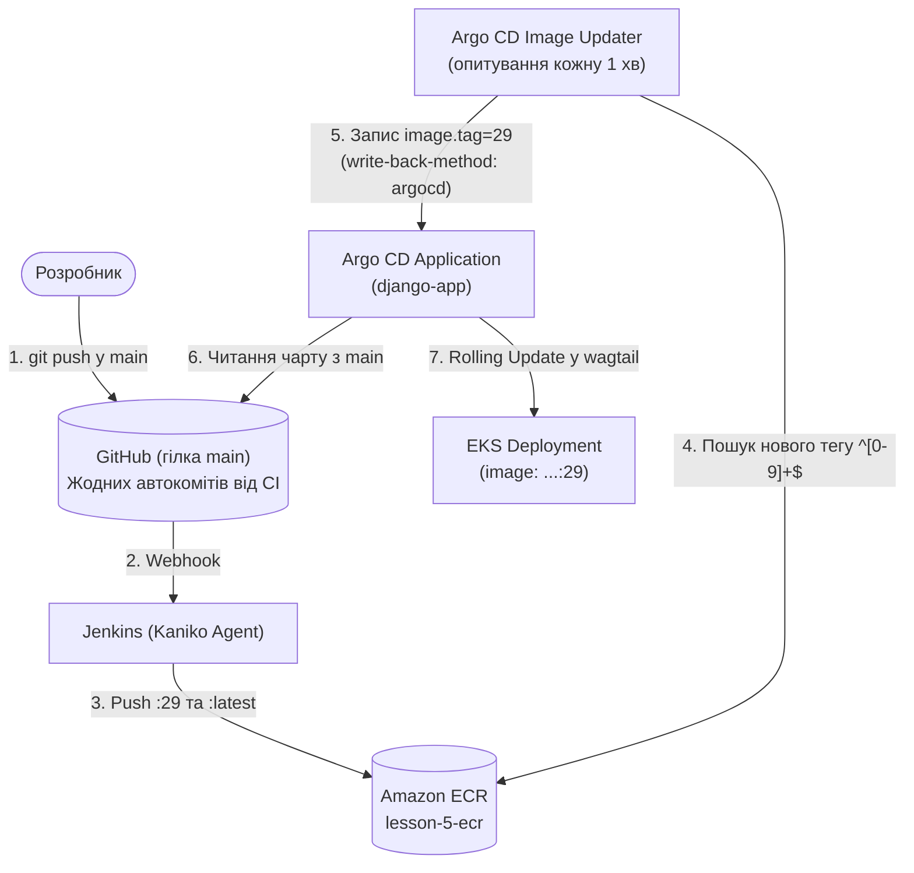

# Усунення зайвих комітів CI у гілку `main` за допомогою Argo CD Image Updater

Цей документ описує, чому виникала проблема постійних автокомітів у гілку `main` під час роботи CI/CD та як її було вирішено шляхом впровадження **Argo CD Image Updater** із механізмом `write-back-method: argocd`.

---

## 1. У чому полягала проблема

У початковій реалізації GitOps-циклу передача номера нового Docker-образу з Jenkins у Kubernetes відбувалася через редагування Git-репозиторію:

1. Розробник робив `git push` у гілку `main`.
2. Jenkins збирав образ через Kaniko і пушив його в Amazon ECR із тегом `${BUILD_NUMBER}` (наприклад, `:27`).
3. Окремий sidecar-контейнер `git` у Jenkins клонував репозиторій, змінював поле `image.tag` у файлі `charts/django-app/values.yaml` та робив автокоміт `chore(cd): update django-app image tag to 27 [skip ci]` безпосередньо в `main`.
4. Argo CD відстежував зміни в `charts/django-app/values.yaml` і оновлював Deployment у кластері.

### Недоліки такого підходу

* **Постійна розсинхронізація локальної гілки `main`:** після кожного білду розробник мусив робити `git pull`, перш ніж відправити наступний коміт (інакше Git відхиляв `push` через новіший коміт від Jenkins).
* **Конфлікти при командній роботі:** коли кілька розробників одночасно вносять зміни, автокоміти CI створюють зайві merge-коміти або конфлікти у `values.yaml`.
* **Засмічення історії Git:** технічні коміти зі зміною цифри тегу змішуються зі змістовною історією розробки коду та інфраструктури.
* **Потреба у `[skip ci]` та правах на запис у GitHub:** без перевірки `[skip ci]` у `Jenkinsfile` автокоміт запускав нескінченний цикл збірок, а токену GitHub у Jenkins доводилося надавати права `Contents: Read and write`.

---

## 2. Архітектурне рішення

Щоб повністю прибрати запис у Git з боку CI, обов'язки були розділені між Jenkins та контролером **Argo CD Image Updater**:

* **Jenkins (CI)** відповідає виключно за збірку Docker-образу з `Django/Dockerfile` та публікацію його в Amazon ECR із тегами `${BUILD_NUMBER}` і `latest`. Робота з Git у `Jenkinsfile` повністю видалена.
* **Argo CD Image Updater (CD)** працює всередині кластера EKS (у неймспейсі `argocd`), кожну хвилину опитує Amazon ECR, знаходить останній числовий тег (`regexp:^[0-9]+$`) і **напряму оновлює Helm-параметри `image.repository` та `image.tag` у ресурсі `Application` (`django-app`) всередині Kubernetes** (`writeBackConfig.method: argocd`).

У результаті:
* Файл `charts/django-app/values.yaml` у гілці `main` завжди залишається незмінним (`tag: "latest"` як базове значення).
* Гілка `main` містить **лише коміти розробників**.
* Argo CD синхронізує маніфести з `main`, але під час рендерингу Helm-чарту підставляє актуальний номер збірки (наприклад, `29`), записаний Image Updater-ом.

---

## 3. Що саме було змінено в репозиторії

### А. Спрощення `Django/Jenkinsfile`

* Із шаблону под-агента видалено контейнер `git`.
* Видалено стадію `Update Chart Tag in Git`.
* Тепер пайплайн складається лише з перевірки середовища та збірки/пушу образу контейнером `kaniko`.
* Права GitHub Personal Access Token у Jenkins зменшено з `Contents: Read and write` до **`Contents: Read-only`**.

### Б. Базовий тег у `charts/django-app/values.yaml`

У `charts/django-app/values.yaml` зафіксовано статичне значення за замовчуванням, яке більше не змінюється ботами:

```yaml
image:
  repository: 250284066941.dkr.ecr.eu-central-1.amazonaws.com/lesson-5-ecr
  tag: "latest"
  pullPolicy: Always
```

### В. Автоматична авторизація в Amazon ECR через IRSA (`modules/argo-cd/argo_cd.tf`)

Тимчасовий пароль доступу до приватного реєстру Amazon ECR діє 12 годин. Щоб `argocd-image-updater` завжди мав дійсні облікові дані без збереження статичних ключів AWS:

1. Створено IAM-роль `eks-cluster-demo-argocd-ecr-role` (через **IRSA** для `ServiceAccount` `ecr-token-refresher` у неймспейсі `argocd`) із правами `ecr:GetAuthorizationToken`, `ecr:ListImages`, `ecr:DescribeImages`, `ecr:BatchGetImage`, `ecr:GetDownloadUrlForLayer`.
2. Додано початковий `Job` (`ecr-token-init`) та періодичний `CronJob` (`ecr-token-refresh`, розклад `0 */6 * * *`), які використовують двохетапну схему без зайвого трафіку через NAT Gateway:
   * `initContainer` (`public.ecr.aws/aws-cli/aws-cli:latest`) отримує токен ECR і записує його в спільний том `emptyDir` (`/token/ecr-password`).
   * `container` (`alpine/kubectl:latest`) створює або оновлює секрет `ecr-credentials` типу `kubernetes.io/dockerconfigjson` у неймспейсі `argocd`.

### Г. Контролер та CRD `ImageUpdater` (`modules/argo-cd/`)

1. **`modules/argo-cd/image-updater-values.yaml`:** налаштовано опитування ECR з інтервалом `--interval 1m`, підключення секрету `pullsecret:argocd/ecr-credentials` та обмеження ресурсів (`requests: 25m CPU / 64Mi RAM`, `limits: 100m CPU / 128Mi RAM`) під вузли `t3.small`.
2. **`modules/argo-cd/charts/templates/image-updater.yaml` та `charts/values.yaml`:** створено ресурс `ImageUpdater` (`apiVersion: argocd-image-updater.argoproj.io/v1alpha1`):
   * `updateStrategy: "newest-build"` — вибирає найсвіжіший зібраний образ;
   * `allowTags: "regexp:^[0-9]+$"` — враховує лише числові теги білдів Jenkins (`28`, `29`, ...), ігноруючи плаваючий тег `latest`;
   * `writeBackConfig.method: "argocd"` — записує вибраний тег безпосередньо в `spec.source.helm.parameters` об'єкта `Application` (`django-app`) без комітів у Git.

---

## 4. Схема нового процесу CI/CD



---

## 5. Команди для перевірки та діагностики

* **Перевірити статус ресурсу `ImageUpdater`:**
  ```bash
  kubectl get imageupdater -n argocd
  ```

* **Перевірити, який тег Image Updater передав у Argo CD `Application`:**
  ```bash
  kubectl get application django-app -n argocd -o jsonpath='{.spec.source.helm.parameters}'; echo
  ```

* **Перевірити фактичний образ у запущеному `Deployment` застосунку:**
  ```bash
  kubectl get deploy django-app-django -n wagtail -o jsonpath='{.spec.template.spec.containers[0].image}'; echo
  ```

* **Переглянути логи роботи `argocd-image-updater`:**
  ```bash
  kubectl logs -n argocd -l app.kubernetes.io/name=argocd-image-updater --tail=30
  ```

* **Перевірити розклад оновлення токена ECR (`CronJob`):**
  ```bash
  kubectl get cronjob ecr-token-refresh -n argocd
  kubectl get secret ecr-credentials -n argocd
  ```