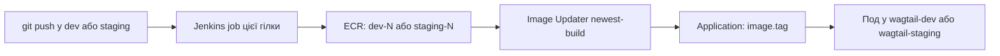

# Оточення dev і staging

Пуш у гілку `dev` збирає образ і викладає його на `https://django-app-dev.dvankevich.pp.ua`. Пуш у `staging` робить те саме для `https://django-app-staging.dvankevich.pp.ua`. Прод (`main` → `https://django-app.dvankevich.pp.ua`) лишається з 2–6 репліками і HPA.

Маніфести всіх трьох оточень Argo CD читає з гілки `main`. Гілка вибирає лише код у образі і префікс тега. Окремий чарт на `dev` чи `staging` не ведеться, інакше Ingress і змінні середовища розійшлися б із `main`.

## Що куди потрапляє

| | prod | dev | staging |
| --- | --- | --- | --- |
| Jenkins job | `django-wagtail-ci` | `django-wagtail-ci-dev` | `django-wagtail-ci-staging` |
| Гілка | `main` | `dev` | `staging` |
| Теги в ECR `lesson-5-ecr` | `:<номер>` і `:latest` | `:dev-<номер>` | `:staging-<номер>` |
| Image Updater | `django-app-updater`, `regexp:^[0-9]+$` | `django-app-dev-updater`, `regexp:^dev-[0-9]+$` | `django-app-staging-updater`, `regexp:^staging-[0-9]+$` |
| Application | `django-app` | `django-app-dev` | `django-app-staging` |
| Namespace | `wagtail` | `wagtail-dev` | `wagtail-staging` |
| Values | `values.yaml` | `values.yaml` + `values-dev.yaml` | `values.yaml` + `values-staging.yaml` |
| Репліки | 2, HPA 2–6 | 1, без HPA | 1, без HPA |
| Service | `LoadBalancer` | `ClusterIP` | `ClusterIP` |
| База на RDS `wagtail-db` | `wagtail` | `wagtail_dev` | `wagtail_staging` |
| S3 | `wagtail-media-lesson5` | `wagtail-media-lesson5-dev` | `wagtail-media-lesson5-staging` |
| IRSA-роль | `eks-cluster-demo-django-media` | `eks-cluster-demo-django-media-dev` | `eks-cluster-demo-django-media-staging` |
| Хост | `django-app.dvankevich.pp.ua` | `django-app-dev.dvankevich.pp.ua` | `django-app-staging.dvankevich.pp.ua` |

Один ECR. Префікс тега не дає dev-образу потрапити на прод: прод-оновлювач приймає лише голі числа. `namePattern` в Image Updater — це glob на повне ім'я, тож шаблон `django-app` не чіпає `django-app-dev`.

`:latest` пушить тільки job гілки `main`. Job `dev` і `staging` цей тег не перезаписують.

## Ланцюжок після пуша



1. Той самий GitHub webhook шле push на `https://jenkins.dvankevich.pp.ua/github-webhook/`.
2. Seed у `modules/jenkins/values.yaml` описує три `pipelineJob`. Кожен дивиться свою гілку (`*/main`, `*/dev`, `*/staging`).
3. `Django/Jenkinsfile` збирає `Django/Dockerfile` через Kaniko. Префікс тега береться з гілки, яку Jenkins вже зачекаутив: `main` дає номер білда і `:latest`, `dev` і `staging` дають `dev-4` чи `staging-4`.
4. Відповідний Image Updater раз на хвилину бере найсвіжіший дозволений тег і записує `image.tag` у свій Application. Коміту в Git немає. Це той самий `write-back-method: argocd`, що й для прода. Подробиці самого механізму — у [`ARGOCD_IMAGE_UPDATER.md`](./ARGOCD_IMAGE_UPDATER.md).
5. Argo CD синхронізує чарт `charts/django-app` з `main` і накладає overlay. Под стартує з `migrate` проти своєї бази.

У звичайному `pipelineJob` Jenkins Git кладе в `GIT_BRANCH` ім'я з префіксом репозиторію: `origin/main`, `origin/dev`, `origin/staging`. Jenkinsfile зрізає `origin/` (також `refs/heads/`, `refs/remotes/` і `remotes/`) і з цієї назви вибирає тег. Окремі змінні job для гілки не використовуються: плагін EnvInject не встановлений, тож блок `environmentVariables` у seed їх не передає в пайплайн. Ім'я job додатково має збігатися з гілкою: `django-wagtail-ci-dev` збирає лише `dev`.

Теги `dev-1`, `dev-2`, `dev-10` не є semver `X.Y.Z`. Без явної стратегії Image Updater сортує їх як рядки, і після дев'ятого білда `dev-9` виглядає новішим за `dev-10`. Тому в `django-app-dev-updater` і `django-app-staging-updater` стоїть `updateStrategy: newest-build`: вибирається образ, який останнім з'явився в ECR. Та сама стратегія вже була у прод-оновлювача.

## Файли в репозиторії

* `Django/Jenkinsfile` — перевірка гілки, префікс тега, `:latest` лише для `main`.
* `modules/jenkins/values.yaml` — два додаткові job у seed DSL.
* `charts/django-app/values-dev.yaml` і `values-staging.yaml` — одна репліка, HPA вимкнено, `Service` типу `ClusterIP`, свій хост, своя база, свій бакет і свій ARN ролі. Решта змінних лишається в `values.yaml`; `AWS_STORAGE_BUCKET_NAME` і `AWS_S3_CUSTOM_DOMAIN` підставляються з `media.bucket`.
* `modules/argo-cd/charts/values.yaml` — Application `django-app-dev` і `django-app-staging` плюс два Image Updater. `createSecrets=false`, automated sync, `CreateNamespace=true`.
* `modules/media-s3` — необов'язковий `name_suffix`. Порожній суфікс лишає прод-роль `eks-cluster-demo-django-media`. У `main.tf` модуль викликається ще двічі: `media_s3_dev` і `media_s3_staging`. Кожна роль пише лише у свій бакет і довіряє лише `system:serviceaccount:<namespace>:django`.
* `outputs.tf` — `media_s3_dev_bucket_name`, `media_s3_dev_role_arn`, `media_s3_staging_bucket_name`, `media_s3_staging_role_arn`.
* `scripts/cicd.sh status` показує також `wagtail-dev` і `wagtail-staging`.

`topologySpreadConstraints` у шаблоні Deployment не змінювались. На одній репліці вони нічого не додають.

## Що зроблено в кластері поза Git

Секрети в репозиторій не потрапляли.

* Terraform застосовано для `module.media_s3_dev`, `module.media_s3_staging`, `module.argo_cd` і `module.jenkins`. Прод-бакет і прод-роль не перейменовувались.
* На RDS `wagtail-db` створені бази `wagtail_dev` і `wagtail_staging`, власник `wagtail_user`. Окремий інстанс RDS не піднімався. Спільна база з продом небезпечна: `Django/entrypoint.sh` на старті виконує `migrate`.
* Секрети `django-app-dev-secret` у `wagtail-dev` і `django-app-staging-secret` у `wagtail-staging` містять `SECRET_KEY` і `POSTGRES_PASSWORD`. На них стоїть `argocd.argoproj.io/sync-options=Prune=false`, як на прод-секреті.
* CNAME `django-app-dev` і `django-app-staging` вказують на той самий ingress ELB, що й прод. cert-manager виписав сертифікати Let's Encrypt для обох імен.
* Service типу `ClusterIP` отримує внутрішню адресу один раз. Рестарт пода, новий образ і sync Argo її не змінюють. Нова адреса з'являється, лише якщо Service видалити і створити знову. Зовнішній трафік іде на спільний ELB ingress-nginx, не на цей ClusterIP. Окремий AWS LoadBalancer для dev і staging не створювався.

## Перевірка

```bash
kubectl get application -n argocd
kubectl get deploy,hpa,certificate -n wagtail-dev
kubectl get deploy,hpa,certificate -n wagtail-staging
curl -fsS -o /dev/null -w "dev:%{http_code}\n" https://django-app-dev.dvankevich.pp.ua/
curl -fsS -o /dev/null -w "staging:%{http_code}\n" https://django-app-staging.dvankevich.pp.ua/
```

У dev і staging має бути одна доступна репліка, жоден HPA і сертифікат `Ready`. Теги ECR дивляться так: у відповіді в одного образу буває кілька тегів, тому колонку `imageTags` не варто друкувати таблицею AWS CLI.

```bash
aws ecr describe-images \
  --repository-name lesson-5-ecr \
  --region eu-central-1 \
  --query 'sort_by(imageDetails,& imagePushedAt)[-8:].[imagePushedAt,join(`,`, imageTags)]' \
  --output text
```

Після пуша в `dev` з'являється тег `dev-<номер>` і параметр `image.tag` у Application `django-app-dev`. Для `staging` тег має вигляд `staging-<номер>`. Голий числовий тег і `:latest` з цих job не з'являються.
